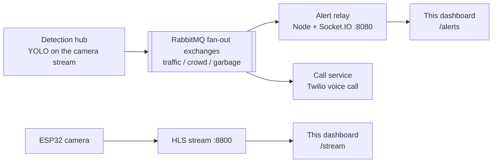

# Urban Eye AI: dashboard

The control-room dashboard for Urban Eye AI, a system where city cameras spot traffic jams, crowds and overflowing garbage, then alert the team that can fix it. Operators watch the live camera feed, see alerts as they happen and test the detection models on their own photos.

**2nd place, Cummins IndoVateAI 2025.** Part of [Urban Eye AI](https://github.com/urban-eye-ai): the [detection hub](https://github.com/urban-eye-ai/Hub-Backend) runs the models, and the [alert relay](https://github.com/urban-eye-ai/admin) pushes alerts to this dashboard.

## Pages

| Route | What it shows |
|---|---|
| `/` | What Urban Eye does and how it works |
| `/stream` | The live camera feed, played in the browser with hls.js |
| `/alerts` | Traffic, crowd and garbage alerts in three live columns, pushed over Socket.IO |
| `/tryout` | Upload a photo, run detection on it and see the boxes drawn on the result |
| `/examples` | Sample detections |

## How alerts reach the screen



Each alert goes to a fan-out exchange, so the dashboard and the phone-call service both receive it without knowing about each other.

## Stack

React · Vite · Tailwind CSS · hls.js · Socket.IO client · simple-peer (WebRTC) · Framer Motion

## Run it

```bash
npm install
npm run dev
```

The dashboard expects these services on the same machine:

| Service | Address |
|---|---|
| Alert relay ([admin](https://github.com/urban-eye-ai/admin)) | `ws://localhost:8080` |
| Camera stream as HLS | `http://localhost:8800/hls/index.m3u8` |
| Detection API for `/tryout` | `http://localhost:5000/detect` |
